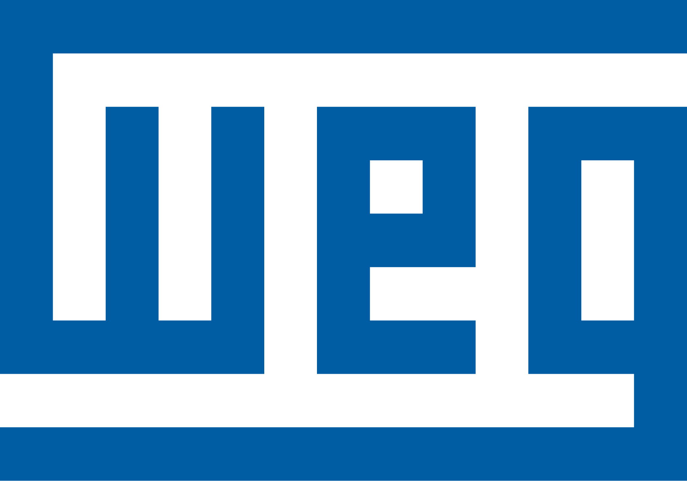

# WEG Assistant

WEG identity edition of ARISE, maintained exclusively on the `weg` branch.

**[Installation, dedicated release and scope](docs/WEG.md)**

The supplied official logo appears from first launch in the orb and application icon. This edition preserves the baseline agent, tools, voice, memory and permissions. It does not publish into ARISE Stable or Preview channels.

Documentation is in English. The interface retains Spanish and English selection.

## 0.4.45 fixes

Agent settings includes **Apply and connect memory**, keeping the application and chat open. The integrated engine includes the reviewed Gentle Shell skill registry backport. See [memory](docs/shared-memory.md) and [registry provenance](vendor/gentle-patches/README.md).
