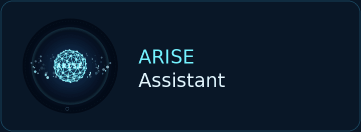
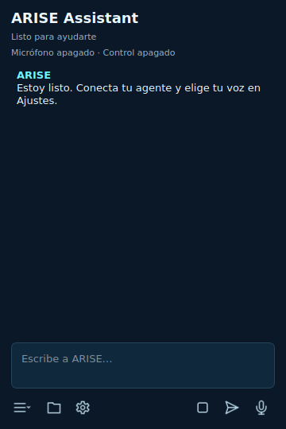

# ARISE Assistant

**QA development: 0.4.42** adds voice stop/exit controls, opt-in study assistance, live Spanish/English UI and guided phone setup. See [usage and acceptance](docs/VOICE-STUDY-LANGUAGE.md). Download tables below describe published artifacts; this QA work does not replace Stable.



ARISE is a desktop assistant with a movable orb, a compact chat panel, voice,
and a resident engine. It runs Gentle Shell inside its own environment: users
do not need to install Pi, Gentle Shell, Node or Go separately.



## Quick navigation

[Downloads](#downloads) · [Windows](#install-windows) · [Linux](#install-linux) · [macOS](#install-macos) · [Android](#install-android) · [iOS](#install-ios) · [Account setup](#connect-your-account-and-test-arise) · [Video](#video-walkthrough)

<!-- arise-published-platforms:start -->
## Downloads

Choose your system and channel. Desktop downloads point to published installers. Mobile web apps are served by your own updated PC; their links open installation instructions.

| Operating system | Architecture | Stable | ARISE Preview | Installation |
| --- | --- | --- | --- | --- |
| Windows 11 | x64 | <!-- arise-windows-stable -->[Complete 0.4.42](https://github.com/Maicololiveras/Arise/releases/download/v0.4.42/ARISE-Setup.exe) · [SHA-256](https://github.com/Maicololiveras/Arise/releases/download/v0.4.42/ARISE-Setup.exe.sha256)<!-- /arise-windows-stable --><br>[Core 0.4.42](https://github.com/Maicololiveras/Arise/releases/download/native-stable-v0.4.42/ARISE-0.4.42-windows-x64-Setup.exe) · [SHA-256](https://github.com/Maicololiveras/Arise/releases/download/native-stable-v0.4.42/ARISE-0.4.42-windows-x64-Setup.exe.sha256) | <!-- arise-windows-preview -->[Complete 0.4.43](https://github.com/Maicololiveras/Arise/releases/download/qa-v0.4.43/ARISE-Setup.exe) · [SHA-256](https://github.com/Maicololiveras/Arise/releases/download/qa-v0.4.43/ARISE-Setup.exe.sha256)<!-- /arise-windows-preview --><br>[Core 0.4.43](https://github.com/Maicololiveras/Arise/releases/download/native-v0.4.43/ARISE-0.4.43-windows-x64-Setup.exe) · [SHA-256](https://github.com/Maicololiveras/Arise/releases/download/native-v0.4.43/ARISE-0.4.43-windows-x64-Setup.exe.sha256) | [Install →](#install-windows) |
| Windows 11 | ARM64 | [Core 0.4.42](https://github.com/Maicololiveras/Arise/releases/download/native-stable-v0.4.42/ARISE-0.4.42-windows-arm64-Setup.exe) · [SHA-256](https://github.com/Maicololiveras/Arise/releases/download/native-stable-v0.4.42/ARISE-0.4.42-windows-arm64-Setup.exe.sha256) | [Core 0.4.43](https://github.com/Maicololiveras/Arise/releases/download/native-v0.4.43/ARISE-0.4.43-windows-arm64-Setup.exe) · [SHA-256](https://github.com/Maicololiveras/Arise/releases/download/native-v0.4.43/ARISE-0.4.43-windows-arm64-Setup.exe.sha256) | [Install →](#install-windows) |
| Linux · Ubuntu 24.04 | x64 | [Core 0.4.42](https://github.com/Maicololiveras/Arise/releases/download/native-stable-v0.4.42/ARISE-0.4.42-linux-x64.deb) · [SHA-256](https://github.com/Maicololiveras/Arise/releases/download/native-stable-v0.4.42/ARISE-0.4.42-linux-x64.deb.sha256) | [Core 0.4.43](https://github.com/Maicololiveras/Arise/releases/download/native-v0.4.43/ARISE-0.4.43-linux-x64.deb) · [SHA-256](https://github.com/Maicololiveras/Arise/releases/download/native-v0.4.43/ARISE-0.4.43-linux-x64.deb.sha256) | [Install →](#install-linux) |
| Linux · Ubuntu 24.04 | ARM64 | [Core 0.4.42](https://github.com/Maicololiveras/Arise/releases/download/native-stable-v0.4.42/ARISE-0.4.42-linux-arm64.deb) · [SHA-256](https://github.com/Maicololiveras/Arise/releases/download/native-stable-v0.4.42/ARISE-0.4.42-linux-arm64.deb.sha256) | [Core 0.4.43](https://github.com/Maicololiveras/Arise/releases/download/native-v0.4.43/ARISE-0.4.43-linux-arm64.deb) · [SHA-256](https://github.com/Maicololiveras/Arise/releases/download/native-v0.4.43/ARISE-0.4.43-linux-arm64.deb.sha256) | [Install →](#install-linux) |
| macOS 15 | Intel x64 | [Core 0.4.42](https://github.com/Maicololiveras/Arise/releases/download/native-stable-v0.4.42/ARISE-0.4.42-macos-x64.pkg) · [SHA-256](https://github.com/Maicololiveras/Arise/releases/download/native-stable-v0.4.42/ARISE-0.4.42-macos-x64.pkg.sha256) | [Core 0.4.43](https://github.com/Maicololiveras/Arise/releases/download/native-v0.4.43/ARISE-0.4.43-macos-x64.pkg) · [SHA-256](https://github.com/Maicololiveras/Arise/releases/download/native-v0.4.43/ARISE-0.4.43-macos-x64.pkg.sha256) | [Install →](#install-macos) |
| macOS 15 | Apple Silicon ARM64 | [Core 0.4.42](https://github.com/Maicololiveras/Arise/releases/download/native-stable-v0.4.42/ARISE-0.4.42-macos-arm64.pkg) · [SHA-256](https://github.com/Maicololiveras/Arise/releases/download/native-stable-v0.4.42/ARISE-0.4.42-macos-arm64.pkg.sha256) | [Core 0.4.43](https://github.com/Maicololiveras/Arise/releases/download/native-v0.4.43/ARISE-0.4.43-macos-arm64.pkg) · [SHA-256](https://github.com/Maicololiveras/Arise/releases/download/native-v0.4.43/ARISE-0.4.43-macos-arm64.pkg.sha256) | [Install →](#install-macos) |
| Android | Installable web app | [Web app · PC 0.4.42](#install-android) | [Web app · PC 0.4.42](#install-android) | [Install →](#install-android) |
| iOS / iPadOS | Installable web app | [Web app · PC 0.4.42](#install-ios) | [Web app · PC 0.4.42](#install-ios) | [Install →](#install-ios) |

**Stable** is the established release channel. **ARISE Preview** is for testing newer builds. Stable Core packages retain the same documented capability limits as Core Preview.

**Complete** and **Core** are different packages: Core packages include the integrated agent engine, but exclude private desktop MCP servers and offline speech models. A higher Core version does not imply feature parity with Complete.

“Not released” means no installer is currently published for that platform and channel. Mobile PWA installation requires no app-store developer account or signing key; native mobile releases are deferred.

<!-- arise-published-platforms:end -->

## Installation guides

Start with the download table above. Follow the section for your operating system;
then connect your account. Back up your profile before upgrading.

### Before you install

Choose the desktop installer that matches your operating system and CPU. Desktop packages include
ARISE's own Gentle Shell 4.7.0, Pi, Node, Gentle AI and Engram; no separate
Gentle installation is required. Sizes below are approximate decimal MB.

<a id="install-windows"></a>

### Install on Windows

**Windows x64 — Complete (Stable or Preview)**

1. In the download table, choose **Complete** under Stable or ARISE Preview. Download `ARISE-Setup.exe` and its checksum.
2. Close ARISE, back up your profile and verify the download. Run the installer as your normal Windows user.
3. Keep the default installation folder. For an upgrade, select your existing installation directory.
4. Launch ARISE from the Start menu and follow [Account setup](#connect-your-account-and-test-arise). You do not need to install Gentle Shell separately.
5. Choose updates from the same channel. Do not run Stable and Preview simultaneously against the shared profile.

**Windows 11 x64 / ARM64 — Core Stable or Preview**

Choose Core Stable or Core Preview in the download table. Stable installs **ARISE Core** in `%LOCALAPPDATA%\Programs\ARISE-Native`; Preview installs **ARISE Preview** in `ARISE-Native-Preview`. The detailed downloads below are the latest published Preview assets. The Complete x64 package is not a native ARM64 installer.


| Architecture | Installer | Size | Integrity |
| --- | --- | --- | --- |
| x64 (Intel / AMD) | [Download EXE](https://github.com/Maicololiveras/Arise/releases/download/native-v0.4.43/ARISE-0.4.43-windows-x64-Setup.exe) | 178 MB | [SHA-256](https://github.com/Maicololiveras/Arise/releases/download/native-v0.4.43/ARISE-0.4.43-windows-x64-Setup.exe.sha256) |
| ARM64 | [Download EXE](https://github.com/Maicololiveras/Arise/releases/download/native-v0.4.43/ARISE-0.4.43-windows-arm64-Setup.exe) | 145 MB | [SHA-256](https://github.com/Maicololiveras/Arise/releases/download/native-v0.4.43/ARISE-0.4.43-windows-arm64-Setup.exe.sha256) |

1. Open **Settings > System > About** and check **System type**. Choose x64 for Intel/AMD x64, or ARM64 for an ARM-based processor.
2. Download the matching EXE from the table. Close ARISE before upgrading and back up the profile folder listed below.
3. Open the EXE and follow Setup. Keep the default folder unless you need another location. Administrator rights are not required.
4. Open **ARISE Preview** from the Start menu. Its default application folder is `%LOCALAPPDATA%\Programs\ARISE-Native-Preview`.
5. Follow **Connect your account and test ARISE** below. No separate Pi, Node or Gentle installation is needed.
6. To update, close ARISE and run the newer matching EXE. To uninstall, use **Settings > Apps > Installed apps > ARISE Preview > Uninstall**. The user profile is preserved.

The preview EXE is unsigned. Verify its source and checksum if Windows blocks it; do not disable system protection.

[Back to downloads ↑](#downloads)

<a id="install-linux"></a>

### Install on Linux

These packages target **Ubuntu 24.04**. Select your CPU architecture and channel in the main download table. For Stable, install the downloaded DEB with `sudo apt install ./<downloaded-file>.deb`, launch `arise`, and uninstall with `sudo apt remove arise-native`. Stable installs at `/opt/arise-native`. The detailed commands below describe Preview (`arise-preview`).


| Architecture | Installer | Size | Integrity |
| --- | --- | --- | --- |
| x64 (amd64) | [Download DEB](https://github.com/Maicololiveras/Arise/releases/download/native-v0.4.43/ARISE-0.4.43-linux-x64.deb) | 200 MB | [SHA-256](https://github.com/Maicololiveras/Arise/releases/download/native-v0.4.43/ARISE-0.4.43-linux-x64.deb.sha256) |
| ARM64 (aarch64) | [Download DEB](https://github.com/Maicololiveras/Arise/releases/download/native-v0.4.43/ARISE-0.4.43-linux-arm64.deb) | 173 MB | [SHA-256](https://github.com/Maicololiveras/Arise/releases/download/native-v0.4.43/ARISE-0.4.43-linux-arm64.deb.sha256) |

1. Use **Ubuntu 24.04** with a graphical desktop. Run `uname -m` in Terminal: `x86_64` means x64; `aarch64` means ARM64.
2. Download the matching DEB. Close ARISE and back up its profile before upgrading.
3. Open Terminal in the folder containing the download. You can use **Open in Terminal** from the Files context menu when available.
4. Run the command matching your CPU. Enter your system password when `sudo` requests it; password characters are not displayed. APT installs the required system libraries.

   **x64:**
   ```bash
   sudo apt install ./ARISE-0.4.43-linux-x64.deb
   ```

   **ARM64:**
   ```bash
   sudo apt install ./ARISE-0.4.43-linux-arm64.deb
   ```

5. Open **ARISE Preview** from the application menu, or run `arise-preview`. Follow the account connection steps below.
6. To update, close ARISE and run `sudo apt install ./<new-installer>.deb`, replacing the placeholder with the new filename. To uninstall:

   ```bash
   sudo apt remove arise-native-preview
   ```

The app is installed in `/opt/arise-native-preview`; removing it preserves the user profile.

These DEBs require Ubuntu 24.04 (glibc 2.39). Other Linux distributions are not certified.

[Back to downloads ↑](#downloads)

<a id="install-macos"></a>

### Install on macOS

These packages target **macOS 15**, with separate Intel and Apple Silicon installers. Choose Stable or Preview in the main table. Stable installs `/Applications/ARISE Core.app`; Preview installs `/Applications/ARISE Preview.app`. The PKG installation steps are the same; launch the app matching your channel.


| Architecture | Installer | Size | Integrity |
| --- | --- | --- | --- |
| x64 (Intel) | [Download PKG](https://github.com/Maicololiveras/Arise/releases/download/native-v0.4.43/ARISE-0.4.43-macos-x64.pkg) | 169 MB | [SHA-256](https://github.com/Maicololiveras/Arise/releases/download/native-v0.4.43/ARISE-0.4.43-macos-x64.pkg.sha256) |
| ARM64 (Apple Silicon) | [Download PKG](https://github.com/Maicololiveras/Arise/releases/download/native-v0.4.43/ARISE-0.4.43-macos-arm64.pkg) | 160 MB | [SHA-256](https://github.com/Maicololiveras/Arise/releases/download/native-v0.4.43/ARISE-0.4.43-macos-arm64.pkg.sha256) |

1. Open **Apple menu > About This Mac**. A **Chip** naming Apple silicon means ARM64; an Intel **Processor** means x64. These packages target macOS 15.
2. Download the matching PKG. Quit ARISE and back up its profile before upgrading.
3. Open the PKG in Finder and follow Installer. Authorize installation with an administrator account when requested.
4. Open **Applications > ARISE Preview**. Its path is `/Applications/ARISE Preview.app`.
5. Follow the account connection steps below. If you enable microphone features and macOS requests access, review and grant the microphone permission for ARISE.
6. To update, quit ARISE and run the newer matching PKG. To uninstall, quit the app and move **ARISE Preview.app** from Applications to Trash. Your profile remains in your Library folder.

The PKG is unsigned and the app is ad-hoc signed, not notarized. Gatekeeper or enterprise policy may block it. Follow your organization's approved process or wait for a signed release; do not disable Gatekeeper.

All six installers passed native installation, engine/UI startup, same-version
reinstallation, removal and profile-preservation checks. See the
[release and reports](https://github.com/Maicololiveras/Arise/releases/tag/native-v0.4.43)
and [successful native CI run](https://github.com/Maicololiveras/Arise/actions/runs/42855558230).

**Preview limits:** private desktop MCP servers and offline speech models are
not bundled; physical microphone, speakers and desktop control still need device
acceptance. Windows and PKG installers are unsigned; macOS apps are ad-hoc signed
and not notarized. Do not disable OS security to install them. Vosk wake listening
is unavailable on macOS and Windows ARM64.

Updates are manual: close ARISE and run the newer matching installer. Preview
and stable use separate application locations but share the standard user
profile; back it up and never run both against that profile simultaneously.
Uninstalling preserves settings, accounts and memory. The complete Windows x64
production release above remains the established desktop option.

[Detailed native installation guide](https://github.com/Maicololiveras/Arise/blob/main/docs/NATIVE-DISTRIBUTIONS.md)

[Back to downloads ↑](#downloads)

<a id="install-android"></a>

### Install on Android

The recommended mobile app is the **installable web app (PWA)** served by your own ARISE PC, starting with PC version **0.4.41**. It requires no APK, signing key or store account. Update the PC from the published Stable or Preview column first; do not use an older host for the new installation experience.

1. Install and configure ARISE on the PC; confirm that chat works.
2. Connect the PC and phone to your authorized Tailscale network.
3. On the PC open **Settings > Connections > Mobile**, configure private HTTPS and the authenticator, and copy the private address.
4. Open that address in Chrome on Android. Tap **Install ARISE** when offered, or the browser menu > **Install app / Add to Home screen**.
5. Open ARISE from its new home-screen icon. Generate a fresh pairing code on the PC and pair inside the installed app with your authenticator code. Browser and installed-app sessions can differ.
6. Send a text message, try **Speak** and **Listen**, and verify **Stop**. Voice recording needs microphone permission and a connected PC; it does not send a prompt until you review and send the transcript.
7. To update the web app, update ARISE on the PC and reopen the mobile app. Keep Tailscale connected and the PC awake. There is no offline task queue or background wake listener.

Previously published native Android Preview APKs remain available in [historical releases](https://github.com/Maicololiveras/Arise/releases/tag/android-qa-v0.2.0-qa). They are optional development builds; the PWA is the current mobile distribution.

[Back to downloads ↑](#downloads)

<a id="install-ios"></a>

### Install on iPhone or iPad

Use the same **installable web app**, with no Apple Developer subscription, TestFlight, App Store or configuration profile. A macOS PKG and an Android APK cannot be installed on iOS.

1. Update the ARISE PC to **0.4.41 or later** once published, and configure its **Settings > Connections > Mobile** private HTTPS address and authenticator.
2. Install Tailscale on the iPhone/iPad and join the same authorized network as the PC.
3. Open the private ARISE address in **Safari**. Tap **Share > Add to Home Screen**; enable **Open as Web App** if that option appears, then tap **Add**.
4. Open the ARISE icon from the Home Screen. Generate a fresh code on the PC and pair in this app with the authenticator code.
5. Test text, microphone recording, response playback and **Stop**. Keep the PC on and connected. iOS can suspend the app when it is hidden or the device locks; continuous background listening is not supported.
6. Update the PC and reopen the web app to receive the latest interface. Removing the icon does not revoke the device: revoke its access in PC Settings when needed.

See the [mobile web app guide](docs/MOBILE-WEB-APP.md). Native [iOS development](docs/IOS-COMPANION.md) is deferred until later; its simulator builds are not phone installers.

[Back to downloads ↑](#downloads)

## Video walkthrough

The installation video is being prepared. Until it is available, use the written guides above.

<!-- arise-video:start -->
<!-- Paste the GitHub-hosted video attachment URL here on its own line once the walkthrough is published. -->
<!-- arise-video:end -->

Maintainers: [how to upload and embed the walkthrough](docs/README-VIDEO.md).

### Connect your account and test ARISE

1. Launch ARISE using the shortcut for your system. Open the orb's chat panel and its Settings button.
2. Open **Settings > Agent > Connect account and choose model**. Select the provider and complete its browser authentication, or enter an API key in the masked field when required. Keep credentials private.
3. Choose an account and an available model, save Settings and send a short text message. Confirm that ARISE replies before testing voice.
4. In Voice settings, select the microphone and speakers. Run the output-only voice test first. For dictation, click the microphone to record, click again to stop and transcribe, then review the draft before sending.
5. Enable local execution or desktop control only for tasks that need them. Core previews do not include private desktop MCP servers or offline models; physical audio and desktop control still require device acceptance.

### Verify your download

Download the **SHA-256** sidecar next to your installer. In the download folder,
run the appropriate command below, replacing the placeholder with the actual
filename. Compare the complete hash with the value in the sidecar. If they differ,
do not install that file; download it again.

| System | Command |
| --- | --- |
| Windows PowerShell | `Get-FileHash -Algorithm SHA256 .\<installer>.exe` |
| Ubuntu Terminal | `sha256sum ./<installer>.deb` |
| macOS Terminal | `shasum -a 256 ./<installer>.pkg` |

### Back up before updating

Close ARISE and copy the entire profile folder to a backup location. Keep the
backup private: it can contain account credentials and memory.

| System | Default profile folder |
| --- | --- |
| Windows | `%LOCALAPPDATA%\ARISE-Orb` — paste into File Explorer's address bar |
| Linux | `~/.local/share/ARISE-Orb`, or `$XDG_DATA_HOME/ARISE-Orb` when configured |
| macOS | `~/Library/Application Support/ARISE-Orb` — Finder > Go > Go to Folder |

If you use `--data-dir`, back up that selected directory instead. Updates and
uninstallers preserve profiles. Do not manually delete the profile folder unless
you intend to remove your settings, conversations and memory.

[Windows installation](docs/INSTALL-WINDOWS.md) ·
[Windows/Linux/macOS x64 and ARM64 previews](docs/NATIVE-DISTRIBUTIONS.md) ·
[Complete documentation index](docs/README.md)

[Stable publication and signing requirements](docs/STABLE-DISTRIBUTIONS.md)

## Included engine

| Component | Pinned version |
| --- | --- |
| Gentle Shell | 4.7.0 |
| Pi | 1.5.0 |
| Gentle AI | 4.4.0 |
| Engram | 3.7.0 |
| gentle-engram | 0.7.0 |
| Bundled Node | 24.21.0 |

The engine owns its agent settings, SDK credentials and memory store. Updates
refresh packaged paths while preserving that state. Existing global accounts
and databases are not silently imported. Advanced users may explicitly choose
an external installation. See [owned runtime](docs/owned-gentle-runtime.md).

## Daily use

- Drag the orb to move it. Click to toggle chat; double-click opens it. Enter
  sends a message and Shift+Enter inserts a line.
- The dictation microphone records on the first click and transcribes on the
  second. Text enters the draft for review; it is never sent automatically.
  The waveform control starts a separate voice conversation.
- Gonzalo uses an online synthesis service. ARISE includes its adapter, not a
  redistributable offline Gonzalo model. Fluent playback prepares the next
  phrase while speaking; optional Windows fallback is visibly reported.
- Wake listening is opt-in. Configure phrases, acknowledgement and whether to
  open the panel. A closed microphone cannot detect a wake phrase.
- Desktop operations hide the chat and temporarily hide/dock the orb before
  capture or input. This does not grant permission to control the computer.
- Projects and chats retain separate sessions and local-execution preferences.
  Delegated tasks can ask questions and receive new instructions in the same
  originating chat. Completion still requires verification of the result.
- Gentle commands are discovered from the running engine. Native dialogs keep
  long content scrollable and response controls reachable.

[Accounts, speech and desktop layout](docs/accounts-voice-desktop-qa.md) ·
[Dictation](docs/DICTATION-PARAKEET-QA.md) ·
[Delegation](docs/delegated-terminal-communication.md)

## Distribution and safety boundaries

Stable and Preview share one source branch, `main`, with separate update indexes.
See [release channels and legacy QA migration](docs/release-channels.md).


The stable Windows x64 installer and native core previews have different
capabilities. Preview installers do not include private desktop MCP servers or
offline model packs, and currently update by manually running the matching installer. macOS previews
are not notarized. Consult the platform guide before downloading.

All installers are published from `main`. The `qa` branch mirrors `main`;
prerelease distributions are named **ARISE Preview**. Each installer accepts only
its channel's version, release URL, size and SHA-256. Tool distributions have
separate manifests. TLS verification remains enabled, including behind proxies.
A checksum is not an independent code-signing identity.

Pi SDK account storage is separate from Windows DPAPI-backed connection secrets.
Private engine directories are configuration separation, not an OS sandbox.
Never publish `auth.json`, `daemon.json`, pairing codes or credential files.
External actions require their applicable approval; ambiguous delivery is not
retried automatically.

Android/Tailscale remains a controlled companion feature. The PC must remain
available. VPS/Coolify deployment is deferred; it is not part of this release.

## Develop and verify

```bash
npm ci --prefix vendor --ignore-scripts
python -m pip install .
QT_QPA_PLATFORM=offscreen python scripts/test.py
cargo test --locked --manifest-path host/Cargo.toml
```

Windows complete build:

```powershell
.\scripts\Build-Windows.ps1 -WithTools -ReposRoot C:\Repos
```

The source directory must contain `screenview-mcp`, `inputcontrol-mcp`,
`transcripcion-ia` and `forge-mcp`. CI needs the corresponding repository access
in `ARISE_COMPONENTS_TOKEN`; ChatGPT's GitHub connection does not supply it to
Actions. Native preview build instructions are in the platform guide.

Docker runs the integration suite with `docker compose run --build --rm tests`.
Tests use real Pi/Gentle with local provider fixtures, real processes and Qt;
they do not certify a physical microphone, desktop permissions or external
accounts. See [validation evidence](docs/VALIDATION.md) and
[release channels](docs/release-channels.md).

The orb reuses the ARISE renderer identity from
[praxisgenai-harness](https://github.com/Maicololiveras/praxisgenai-harness/blob/main/docs/ARISE-ORB.md).
JetBrains Mono retains its OFL license. Bundled dependencies retain their
respective licenses and attribution.

## Shared local memory (0.4.43 Preview)

Choose private memory or an existing compatible local Engram server in Settings > Agent > Memory without changing the integrated engine. Private memory remains the default. See [setup, ownership and recovery](docs/shared-memory.md).
