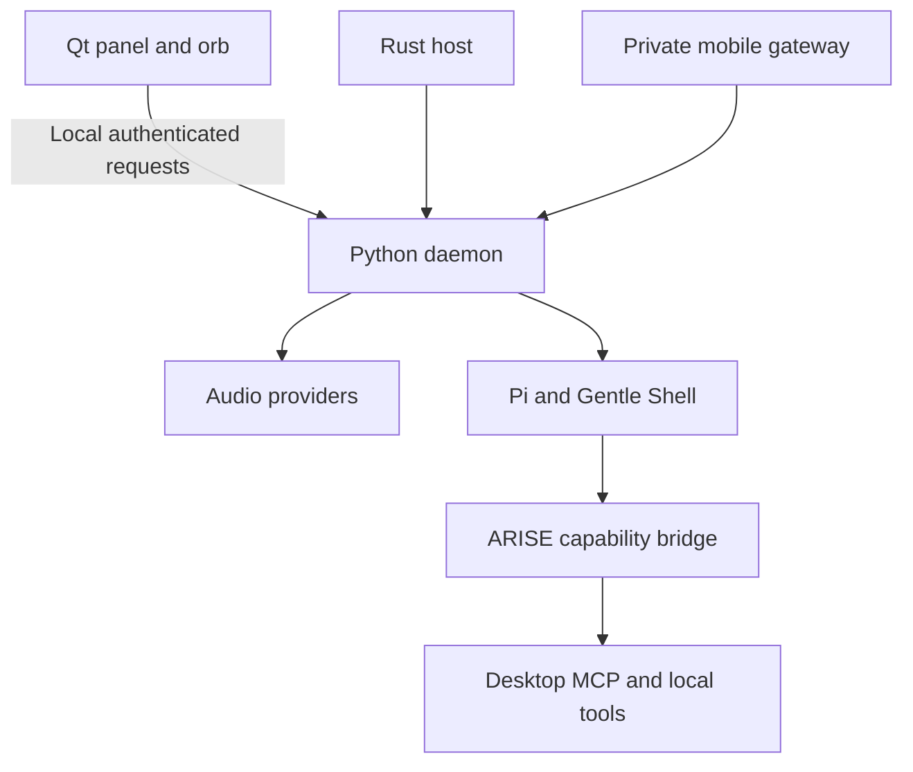

# ARISE runtime architecture

Qt owns the orb and settings/chat windows. A Python daemon owns storage, audio,
tasks and authenticated local routes. The Rust host starts and waits for the
engine; it is not a second agent loop. Pi runs the model loop with Gentle Shell
extensions inside ARISE's private runtime.

Closing the chat hides it; exiting ARISE stops owned work, voice and desktop
control. Interrupted work is not replayed after a restart. Desktop operations
are serialized and require authorization. Stop revokes permission before
waiting for cancellation. Overlay acknowledgement precedes desktop capture/input.

The internal bridge rejects browser origins and requires a capability token.
Account operations require a separate renderer capability. Windows protects
stored bridge tokens with DPAPI; POSIX descriptors use mode 0600. These controls
do not isolate malicious code already running as the same OS user.

SDK account credentials live in the private agent's native auth store, not in
chat messages. Connection secrets have separate storage rules. External content
is data, not new authority. Gmail records an attempt before delivery and does
not automatically retry an ambiguous send.

## Projects and delegated work

SQLite indexes projects and chats. Chat folders retain metadata, preferences,
messages and Pi's original JSONL session. The selected chat owns its RPC process;
switching cancels active work and rejects late events from the old generation.
Subsequent project chats use Git worktrees when available or independent copies.
Closing a chat neither merges nor deletes its worktree.

The launcher uses Gentle's official invocation contract and resumes the explicit
session file. RPC adapters preserve upstream command handlers and approval
policies. Delegated children receive the adapted extensions, but do not inherit
desktop-control permission. A per-task mailbox supports questions and steering
within the originating chat; restart does not replay or reconnect old tasks.

Local execution authorization is per chat. A working directory is not a filesystem
sandbox. Native DOCX creation and workspace file tools remain independently bounded.
Private model reasoning is not displayed as public agent activity.

## Voice and platform boundaries

Realtime providers have separate protocols and credentials. Local conversation
uses STT, a text model and TTS; it is not an end-to-end speech-to-speech model.
Dictation only inserts a draft. Wake capture is opt-in and depends on a compatible
Vosk runtime/model. Gonzalo is an online adapter, with bounded synthesis and one
chunk of look-ahead. Physical echo cancellation is not implemented.

See [owned engine](owned-gentle-runtime.md), [native distributions](NATIVE-DISTRIBUTIONS.md),
[mobile access](MOBILE-GUIDED-QA.md) and [validation](VALIDATION.md).
